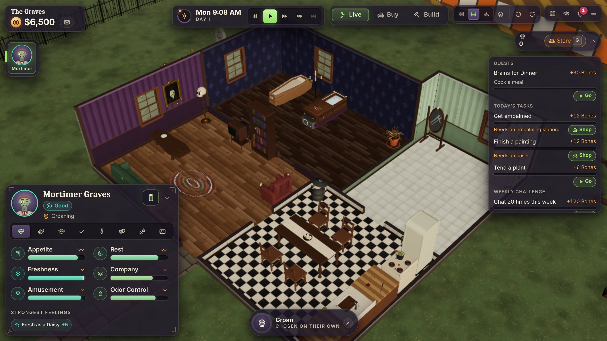
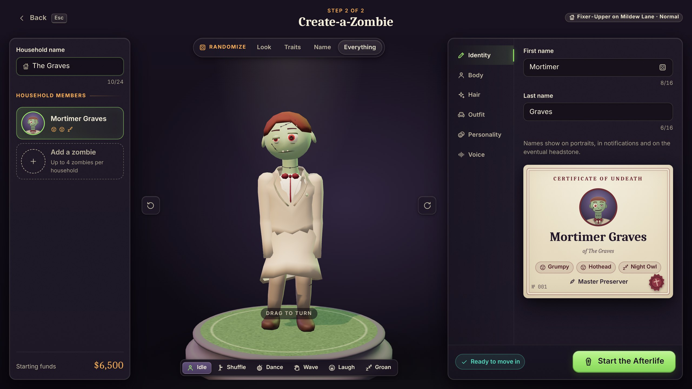
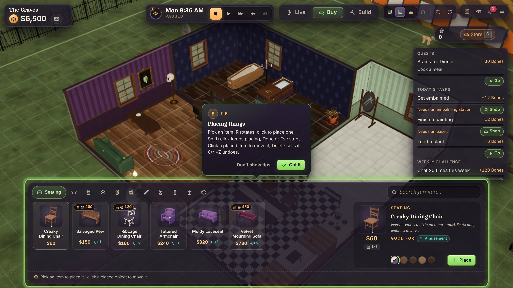
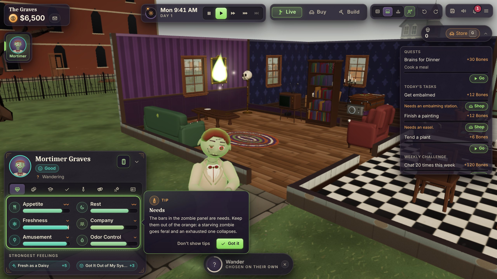
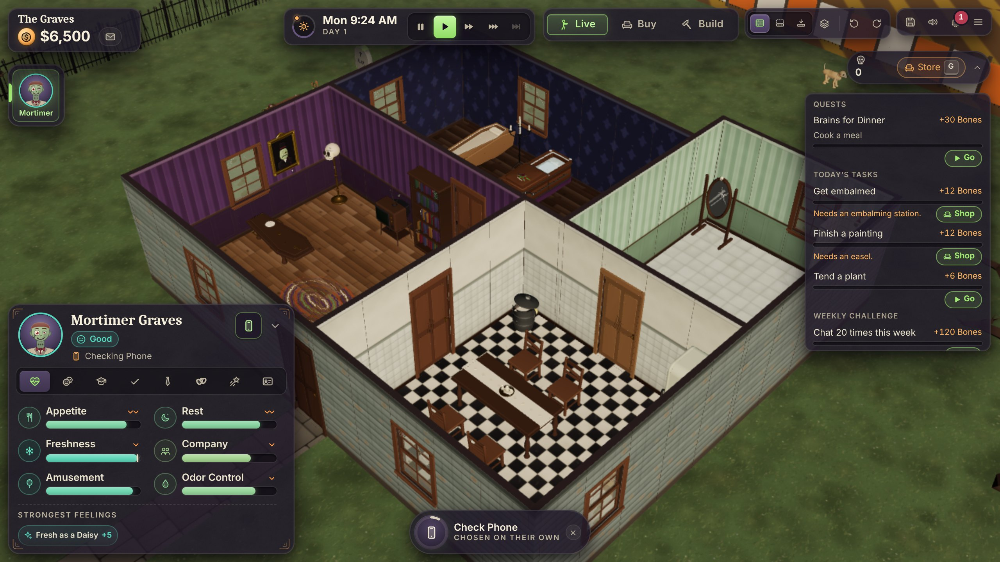

# Afterlife Lease

> *Death didn't get you out of paying rent.*

A life sim where **you play the zombies**. Run a household of the undead in the town of Wormwood Heights: jobs, bills,
dinner parties, pets and home décor, while your zombies slowly rot and keeping them fresh competes with every other
expense. It runs in a browser and as a Windows desktop app, entirely on your own device.



**This is an open project, and you are invited to build it with us.** Add furniture, careers, pets, places in the
world, fixes or whole new systems. Start with [CONTRIBUTING.md](CONTRIBUTING.md).

| | |
|---|---|
|  |  |
| Create-a-Zombie: looks, traits, a voice | Buy mode: furnish the place |
|  |  |
| Follow a zombie over the shoulder | The house with its walls up |

## What makes it different

- **The same game every time.** The simulation is deterministic: the same save and the same actions always give the
  same world. Every action is recorded, so a crash loses nothing and any bug can be replayed exactly.
- **Art you can rebuild.** Nearly every 3D model is generated by Blender scripts in [`tools/blender/`](tools/blender/),
  not painted by hand somewhere else. Change a script, run it, and you get a new chair, house or zombie. The few
  files that are not script-made are listed in [CREDITS.md](CREDITS.md).
- **No sound files.** Every sound effect, the zombie language and the music are synthesised while the game runs.
- **Saves that survive.** Checksummed saves, automatic backups, and tests that kill the game at every write.
- **Built with AI agents.** Most of the code was written by AI coding agents under the owner's direction, and
  agent-assisted contributions are welcome. See [AGENTS.md](AGENTS.md).

Made by [rblake2320](https://github.com/rblake2320) · [aihangout.ai](https://aihangout.ai)

## Status

Early access, in active development (version 1.0.0).

| Area | State |
|---|---|
| Life sim: needs, decay, careers, social life, build and buy, sound, saves | Playable |
| Story start: claim the Condemned Shack, Act 1 | Playable |
| Walkable world: walk to the neighbours, the street and the graveyard | Playable, new |
| Pets and wildlife, home building, roofs and ceilings | Playable, new |
| Accounts, online play, a store with real money | Designed only, not built |

Everything runs on your device. There are no accounts, no servers and no data collection.

Where it is going, including Frontier mode and Eviction Night (opt-in raid nights): **[ROADMAP.md](ROADMAP.md)**. What changed lately: [CHANGELOG.md](CHANGELOG.md).

A playable web build is published from `main` by [the Pages workflow](.github/workflows/pages.yml) once GitHub Pages is
switched on for the repository.

## Run it

You need [Node.js](https://nodejs.org) 22.12 or newer.

```sh
npm ci
npm run dev
```

Open the address it prints (http://localhost:5173) and press **New Game**.

## Check your changes

```sh
npm run typecheck   # TypeScript, no output files
npm test            # unit and adversarial tests (about 20 minutes)
npm run build       # the web build, into dist/
```

The same checks run on every pull request. [docs/TESTING.md](docs/TESTING.md) lists every suite and what it proves.

## Project layout

| Folder | What's in it |
|---|---|
| `src/sim/` | The game rules: needs, careers, pets, the world. Deterministic |
| `src/game/` | The controller between the rules, the picture and the interface; input; saving |
| `src/render/` | The 3D picture (three.js): world, objects, characters, effects |
| `src/ui/` | Menus, the in-game interface, dialogs (Preact) |
| `src/audio/` | The sound synthesiser: effects, zombie voice, music |
| `src/persistence/` | Crash-safe saves, backups, migrations |
| `tools/blender/` | The scripts that generate the 3D models |
| `public/assets/` | The built models the game downloads |
| `tests/` | Unit tests, and browser tests that play the built game |
| `docs/` | Design, architecture, decisions and the work board |

[docs/ARCHITECTURE.md](docs/ARCHITECTURE.md) explains how the pieces fit together.

## Contribute

Read [CONTRIBUTING.md](CONTRIBUTING.md). Every change goes through a pull request that the owner reviews. Using an AI
coding agent? Point it at [AGENTS.md](AGENTS.md). Ideas for the game: open a **Feature request** issue. Good first
tasks: [docs/community/STARTER_TASKS.md](docs/community/STARTER_TASKS.md).

**Feedback from inside the game:** press **F8** (or Pause → Report a bug) to write a bug report or an idea. It takes a
screenshot, attaches technical details with names and typed text scrubbed out, and saves a report file you can attach
to a **Playtest feedback** issue. Nothing is sent anywhere by itself.

Found a security problem? Don't open an issue. See [SECURITY.md](SECURITY.md).

## Licence

The code, and the art and audio our scripts generate, are under the [MIT licence](LICENSE). A few files are not; they
are listed in [CREDITS.md](CREDITS.md). The MIT licence does not cover the **Afterlife Lease** name and logo: please
don't use those for your own game or in a way that suggests it's official.

---

# Reference

## Windows desktop app and other builds (PowerShell)

### Prerequisites

* **Node.js ≥ 22.12** (`engines` in `package.json`) with npm ≥ 10 — check with:

  ```powershell
  node --version
  npm --version
  ```

* Git. No other global tools are needed; every build tool is a pinned `devDependency`.

### Install, run, test

```powershell
git clone https://github.com/rblake2320/ALL.git
Set-Location ALL
npm ci                      # exact versions from package-lock.json (also downloads the Electron binary)
npm run dev                 # browser build with hot reload: http://localhost:5173 (port is strict)
npm test                    # unit + adversarial test suites (Vitest)
npm run typecheck           # renderer + Electron TypeScript, no emit
npm run e2e                 # browser E2E on the production build (needs Playwright + Chromium, see docs/TESTING.md)
```

### Desktop app and installer

```powershell
npm run electron:start      # web build -> compile electron/ -> launch the desktop app
npm run electron:dev        # Vite dev server (hot reload) + Electron pointed at it
npm run dist:win            # NSIS installer -> release\<version>\AfterlifeLease-Setup-<version>-x64.exe
```

`scripts\build-windows.ps1` is the full release pipeline in one command (Node/npm check → `npm ci` → typecheck →
tests → asset verification → web build → Electron build → installer → SHA-256 printed and written next to the
`.exe`). Flags: `-SkipInstall`, `-SkipTests`.

```powershell
powershell -ExecutionPolicy Bypass -File scripts\build-windows.ps1
```

### Other builds

```powershell
npm run build               # web build -> dist\ (relative base: works from any static host or sub-path)
npm run build:single        # single-file web build -> dist-single\index.html (+ dist-single\assets\)
npm run build:single -- --inline-assets   # embed assets (< 12 MB total) so index.html alone is the game
npm run preview             # serve dist\ at http://localhost:4173
npm run verify:assets       # check every asset against the SHA-256 manifests in public\assets
```

### Linux / macOS deltas

* Same npm scripts; use `/` paths. On machines that never launch Electron (CI, containers) skip the binary download:

  ```bash
  ELECTRON_SKIP_BINARY_DOWNLOAD=1 npm ci
  ```

  PowerShell equivalent: `$env:ELECTRON_SKIP_BINARY_DOWNLOAD=1; npm ci`.
* `npm run electron:dev` / `electron:start` need the binary (`node node_modules/electron/install.js` installs it later).
* `npm run dist:win` targets Windows NSIS; build it on Windows (or in the CI Windows job, which uploads the installer
  as an artifact — see `.github/workflows/ci.yml`).

---

## Features

* **Create-a-Zombie**: 1–4 household members — name, look, three traits, an aspiration, a voice; randomize.
* **Needs & decay economy**: six needs (Appetite, Rest, Freshness, Company, Amusement, Odor Control); Freshness
  decays permanently and is restored by refrigerated coffins, ice baths, embalming and preservative spray; limbs can
  fall off.
* **Autonomy**: utility AI picks what each zombie does when you don't; full / limited / off.
* **Careers**: five tracks × five levels with carpool hearse, daily performance, promotions and work-choice events.
* **Social life**: 24 seeded townies, walk-bys, drop-ins, invitations, parties, friendship and romance.
* **Aspirations & Reward Store**, random life events, bills and power.
* **Build & Buy**: walls, rooms, doors/windows, floors, paint, 81 object/environment models; exact-refund undo/redo.
* **Time**: pause, 1×, 2×, 3× and ultra speed (when every household zombie is asleep or at work).
* **Fully procedural audio**: SFX, the zombie voice language, adaptive score and ambience are synthesised at runtime
  (no sample files).
* **Story start**: claim a condemned shack and build it up through the Act 1 story; quests, daily tasks, weekly
  challenges and Bones.
* **Crash-safe saves**: SHA-256-verified envelopes, automatic backup of the previous good save, schema migrations,
  `.alsave` export/import, autosave.

Design numbers live in [docs/GDD.md](docs/GDD.md); module structure in [docs/ARCHITECTURE.md](docs/ARCHITECTURE.md).

---

## Controls

Generated from `KEYMAP` in `src/game/contracts.ts` with the HUD's own labeler (`src/ui/hud/lib/keys.ts`) and the
English action names from `src/i18n/en.ts`. On macOS, Ctrl shortcuts also accept ⌘ (the controller treats Meta as
Ctrl). Hotkeys are ignored while typing in a text field or while a menu/dialog has focus (that widget handles its own
keys); Esc closes the innermost UI layer first.

| Action | KEYMAP id | Keys |
|---|---|---|
| Pause / resume | `pause` | `Space`, `0`, `` ` `` |
| Normal speed | `speed1` | `1` |
| Fast | `speed2` | `2` |
| Faster | `speed3` | `3` |
| Ultra speed | `speedUltra` | `4` |
| Live mode | `modeLive` | `F1`, `L` |
| Buy mode | `modeBuy` | `F2`, `B` |
| Build mode | `modeBuild` | `F3`, `U` |
| Rotate camera left | `rotateCamLeft` | `Q`, `,` |
| Rotate camera right | `rotateCamRight` | `E`, `.` |
| Pan forward | `panUp` | `W`, `↑` |
| Pan back | `panDown` | `S`, `↓` |
| Pan left | `panLeft` | `A`, `←` |
| Pan right | `panRight` | `D`, `→` |
| Zoom in | `zoomIn` | `=`, `Num +`, `Z` |
| Zoom out | `zoomOut` | `-`, `Num −`, `X` |
| Cycle wall view | `wallMode` | `C`, `PgUp` |
| Rotate object (Buy mode; Shift reverses) | `rotateObject` | `R` |
| Sell / delete (Buy mode) | `sell` | `Del`, `Backspace` |
| Undo | `undo` | `Ctrl+Z` |
| Redo | `redo` | `Ctrl+Y`, `Ctrl+Shift+Z` |
| Next zombie (Shift: previous) | `cycleZombie` | `Tab` |
| Move between HUD panels | `focusHud` | `F6`, `Shift+F6` |
| Focus camera on zombie | `focusSelected` | `F` |
| Help | `help` | `F10`, `?` |
| Quick save | `quickSave` | `F5`, `Ctrl+S` |
| Menu / close | `menu` | `Esc` |

Desktop only (`electron/main.ts`): **F11** toggles fullscreen; F12 opens DevTools in unpackaged dev runs only.

Mouse (`src/game/input/pointer.ts`): left click selects / uses the mode tool (drag past a threshold pans); right
click cancels/closes, right-drag orbits, Shift+right-drag pans; middle-drag or Space+left-drag pans; wheel zooms
(Settings → invert zoom); touch: one finger = left button, two fingers pinch-zoom and pan.

---

## Where saves live

From `electron/main.ts` (`app.setPath('userData', <appData>/Afterlife Lease)`, saves in `userData/saves`) and
`src/persistence/backends/`:

| Platform | Saves | Also |
|---|---|---|
| Windows desktop | `%APPDATA%\Afterlife Lease\saves\` | logs `%APPDATA%\Afterlife Lease\logs\main.log`; window placement `%APPDATA%\Afterlife Lease\window-state.json` |
| macOS desktop | `~/Library/Application Support/Afterlife Lease/saves/` | `logs/`, `window-state.json` alongside |
| Linux desktop | `~/.config/Afterlife Lease/saves/` | `logs/`, `window-state.json` alongside |
| Browser | IndexedDB database `afterlife-lease`, store `kv` | fallback: `localStorage` keys `afterlife-lease:*`; in-memory when storage is unavailable |

Per slot on desktop: `slot.<id>.primary.dat` (current), `.backup.dat` (previous good save), `.meta.dat` (listing
cache). Uninstalling keeps saves. Format, crash-safety and recovery details: [docs/PLATFORM.md](docs/PLATFORM.md).

Open the saves folder:

```powershell
explorer "$env:APPDATA\Afterlife Lease\saves"
```

---

## Troubleshooting

| Symptom | Fix |
|---|---|
| `npm warn EBADENGINE`, then build/test errors | Node is older than 22.12 — install Node 22 LTS (22.12 or newer) and reopen PowerShell. |
| `npm ci` hangs or fails downloading Electron (proxy) | For builds/tests only: `$env:ELECTRON_SKIP_BINARY_DOWNLOAD=1; npm ci`. Desktop runs need the binary later: `node node_modules/electron/install.js`. |
| `npm run dev` says port 5173 is in use | Another Vite server is running (the port is strict). Stop it, or run `npx vite --port 5180 --strictPort`. |
| Scripts blocked: "running scripts is disabled on this system" | Run `.ps1` files with `powershell -ExecutionPolicy Bypass -File <script>`. npm scripts are unaffected. |
| "The save file is locked by another program" | Antivirus / OneDrive / backup tools briefly lock files; writes already retry. Add an exclusion for `%APPDATA%\Afterlife Lease` or pause the sync tool. Old saves are never damaged by a failed write. |
| "Not enough storage space to save" | Free disk space on the `%APPDATA%` drive (browser: site storage quota). Delete or export old slots. |
| Second launch does nothing | Only one instance may run (it owns the saves folder); the running window is focused. Check Task Manager for a hung `Afterlife Lease.exe`. |
| Window off-screen after unplugging a monitor | Delete `%APPDATA%\Afterlife Lease\window-state.json`. |
| SmartScreen warns about the installer | Builds are unsigned unless `CSC_LINK` / `CSC_KEY_PASSWORD` are set — see [docs/SHIP_CHECKLIST.md](docs/SHIP_CHECKLIST.md). |
| Black screen / "couldn't start" splash | Copy the details from the splash into a bug report; desktop logs are in `%APPDATA%\Afterlife Lease\logs\main.log`. Update GPU drivers (WebGL is required). |
| Line-ending noise in `git diff` | The repo normalises to LF (`.gitattributes`; `.ps1/.cmd/.bat` are CRLF). Run `git add --renormalize .` once if an editor rewrote files. |

More: [docs/PLATFORM.md §9](docs/PLATFORM.md) (storage), [docs/TESTING.md](docs/TESTING.md) (test suites).

---

## Documentation

| File | Contents |
|---|---|
| [docs/ARCHITECTURE.md](docs/ARCHITECTURE.md) | Module map, data flow, determinism, persistence, plugin seams |
| [docs/TESTING.md](docs/TESTING.md) | Every test command and what each suite proves |
| [docs/SHIP_CHECKLIST.md](docs/SHIP_CHECKLIST.md) | Release steps (Windows NSIS + web single-file), signing, versioning, smoke test |
| [docs/PLATFORM.md](docs/PLATFORM.md) | Persistence, desktop app, build tooling |
| [docs/CONTRACTS.md](docs/CONTRACTS.md) | Module contracts and ownership |
| [docs/GDD.md](docs/GDD.md) / [docs/BALANCE.md](docs/BALANCE.md) | Design numbers / balance method |
| [docs/IP_NOTES.md](docs/IP_NOTES.md) | Originality and trademarks |
| [THIRD_PARTY_NOTICES.md](THIRD_PARTY_NOTICES.md) | Third-party licenses |
| [docs/DECISIONS.md](docs/DECISIONS.md) / [docs/WORKBOARD.md](docs/WORKBOARD.md) | Decision log / live work items and owners |
| [docs/DESIGN_WORLD_LEVELS.md](docs/DESIGN_WORLD_LEVELS.md) | World and levels. The walkable-world and regional-calendar redesign (W-025) is in review in PR #57 |
| [docs/DESIGN_OPEN_WORLD.md](docs/DESIGN_OPEN_WORLD.md) | Open-world direction (W-135): perspectives, generated districts, private homes with permission levels, crews, the raid event; build specification, roadmap R0–R11 and open owner decisions |
| [docs/MONETIZATION.md](docs/MONETIZATION.md) | Economy, store, sponsorship, minors rules |
| [docs/SECURITY.md](docs/SECURITY.md) | Security model and threat table |
| [CONTRIBUTING.md](CONTRIBUTING.md) | How to contribute |
| [CHANGELOG.md](CHANGELOG.md) | Release history |
