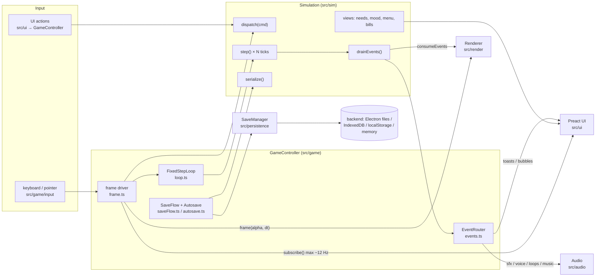

# Afterlife Lease — Architecture

How the game is put together: which code lives where, how one frame flows from the simulation to the screen and the
speakers, what keeps the simulation deterministic, how saves are stored, and where new content and systems plug in.
Binding interfaces live in the contract files listed in [CONTRACTS.md](CONTRACTS.md). If this page and a contract
disagree, the contract is right and this page has a bug.

---

## 1. Module map

| Layer | Path | Entry point | Responsibility |
|---|---|---|---|
| Bootstrap | `src/main.tsx`, `index.html` | — | Builds every module from its factory, creates the GameController, mounts the UI over the full-screen canvas, unlocks audio on the first gesture. Falls back to in-memory storage when real storage cannot open. If anything fails before the UI mounts, the boot splash shows the error. |
| Shared vocabulary | `src/shared/` | `catalog.ts`, `dimensions.ts`, `appearance.ts`, `styles.ts`, `audioIds.ts` | Object specs (ids, footprints, slots), physical conventions, appearance and animation names, wall/floor styles, sound ids. Owned by the integration lead. |
| Simulation | `src/sim/` | `src/sim/index.ts`: `createNewWorld`, `createSimulation`, `loadContent`, `repairWorld`, `LOT_TEMPLATES` | Deterministic world model. `types.ts` = `WorldState` (also the save format); `contracts.ts` = `SimulationAPI`, `SimSystem`, `ContentModule`; `rng.ts` (xoshiro128\*\*), `time.ts`, `vocabulary.ts`. |
| ↳ engine | `src/sim/engine/` | `createSimulationWith`, `loadContentFrom`, `engineContent` | Tick runner, interaction state machine, autonomy, needs, effects/requirements registries, commands, views, repair, invariants. Semantics: `src/sim/engine/README.md`. |
| ↳ spatial | `src/sim/spatial/` | `createSpatial`, `createBuildService`, `createLotTemplate` | Grid, rooms, pathfinding, slots, placement rules, Build/Buy commands with exact-refund undo/redo, lot templates. |
| ↳ domain content | `src/sim/content/home/`, `src/sim/content/people/` | `homeContent`, `peopleContent` | Data: objects, interactions, recipes, moodlets, traits, careers, aspirations, life events, names. |
| ↳ domain systems | `src/sim/systems/home/`, `src/sim/systems/people/` | `homeSystems`, `peopleSystems` | Behaviour: decay, food, economy, upkeep; social, careers, townies, aspirations, events. |
| Game controller | `src/game/` | `controller.ts`: `createGameController` | Owns the session, fixed-timestep loop (`loop.ts`), per-frame driver (`frame.ts`), event routing (`events.ts`), input (`input/`), save/autosave flow (`saveFlow.ts`, `autosave.ts`), settings and profile, toasts, hints. `simModule.ts` is the only file in `src/game` that imports the engine. Contract: `src/game/contracts.ts` (GameController, KEYMAP, settings). |
| Rendering | `src/render/` | `src/render/index.ts`: `createRenderer` | Three.js scene: camera rig, lighting/sky, walls/floors/cutaway, static batching, agents and interpolation, FX, overlays, picking, thumbnails, post-processing. Contract: `src/render/contracts.ts`. |
| ↳ models | `src/render/models/` | `createModelLibrary` | GLB loading per `public/assets/manifest.objects.json`, variants, dynamic parts, placeholder fallback. |
| ↳ characters | `src/render/characters/` | `createCharacterFactory` | Zombie rig from `manifest.characters.json`: clips, posture, limbs, faces, carry anchors, fallback rig. |
| Audio | `src/audio/` | `src/audio/index.ts`: `createAudio` | Procedural WebAudio: SFX recipes, "Groanish" voice, adaptive music, ambience, loops, mixer graph. Contract: `src/audio/contracts.ts`. Details: `src/audio/README.md`. |
| UI | `src/ui/` (`App.tsx`, `shell/`, `hud/`, `theme/`, `common/`), `src/i18n/` | `App({ game })`, `Hud()` | Preact UI. The shell covers menus, Create-a-Zombie, dialogs and settings; the HUD covers in-game panels, the phone, careers and rewards. It reads only from the GameController (`useGame()`), never from the sim directly. |
| Persistence | `src/persistence/` | `createSaveManager`, `createProfileStore` | Save envelope, checksums, gzip, migrations, validation and repair, backends, cross-tab locks. Contract: `src/persistence/contracts.ts`. Details: [PLATFORM.md](PLATFORM.md). |
| Desktop shell | `electron/` | `main.ts`, `preload.ts` | Window, `app://game/` protocol + CSP, single-instance lock, crash/hang recovery, file-backed save store (`fileStore.ts`), validated IPC (`ipcHandlers.ts`), rotating log. Packaging: `electron/electron-builder.json`. |
| Build tooling | `scripts/` | npm scripts | `inline-build.mjs` (single-file build), `verify-assets.mjs`, `build-electron-main.mjs`, `dev-electron.mjs` / `.ps1`, `build-windows.ps1`. |
| Asset pipeline | `tools/blender/` | `objects/build_all.py`, `characters/build_zombie.py` | Headless Blender (`bpy`) scripts that generate every GLB in `public/assets/models/` plus the SHA-256 manifests. Not shipped. |
| Dev harnesses | `dev/` | `dev/<module>.html`, `*.cjs` / `*.mjs` drivers | Per-module pages and Playwright drivers for screenshots, perf and browser e2e (see [TESTING.md](TESTING.md)). Not shipped. |

---

## 2. Data flow



One frame (`src/game/frame.ts` on `requestAnimationFrame`):

1. **Step.** `loop.ts` adds `realDt × minutes-per-second(speed) / TICK_MINUTES` to an accumulator and runs up to
   `MAX_TICKS_PER_FRAME` whole `sim.step()` calls. It drops any excess instead of carrying it over, so a stall never
   snowballs, and a CPU budget per frame guards slow machines. The fractional remainder becomes the interpolation
   alpha. When rAF stops (hidden window), a slow timer keeps the game simulating if "pause when unfocused" is off.
2. **Commands.** Input and UI actions become `Command`s through `GameSession.dispatch()`, a fault barrier that never
   throws and also counts successful commands for autosave idempotency. Nothing else mutates the world.
3. **Events.** `sim.drainEvents()` goes first, raw, to `renderer.consumeEvents()`, then to the `EventRouter`. The
   router wraps each event in its own try/catch, caps sfx/voice per frame, pairs achievements with their toasts, and
   tracks loops per emitter.
4. **Render.** `renderer.frame(alpha, dtSec)` interpolates agents between ticks and draws the scene.
5. **UI.** The controller notifies subscribers at most about 12× per second. Panels pull view models (`needs()`,
   `mood()`, `menu()`, `bills()`, …) through the controller.
6. **Persistence.** The autosave scheduler (`autosave.ts`) and manual saves (`saveFlow.ts`) capture `serialize()` +
   `SaveMeta` **synchronously**, then hand them to the SaveManager. Saves are serialized and watchdogged, and a
   failure becomes `{ ok: false }` plus a toast. Between snapshots every command is write-ahead journaled (§4.1).

The main menu runs a live **demo world** (`demoWorld.ts`) through the same path.

---

## 3. Determinism rules

The simulation must give the same result from the same `WorldState` and the same commands on every machine:

* **No ambient randomness or clocks in `src/sim/**`.** Do not use `Math.random()`, `Date.now()` or
  `performance.now()`. A grep at the time of writing finds them only in a comment in `src/sim/rng.ts`. Randomness
  comes from `ctx.rng` / `createRng(state.rng)` (xoshiro128\*\*, seeded by splitmix32). Its state lives **inside**
  `WorldState`, so a loaded save resumes the same sequence.
* **Time is ticks.** 1 tick = 0.25 game minutes (`TICK_MINUTES`). Rates are per game hour. Real time enters only in
  the controller's accumulator, never in the sim.
* **State is plain JSON.** No class instances, functions, `undefined` or NaN in `WorldState`. `serialize()` returns
  a deep JSON-safe copy.
* **Systems are stateless.** `SimSystem` objects are shared by every simulation (menu demo + game). They read the
  world only through the `ctx` that `ctx.sys(id)` appends as the last argument (CONTRACTS.md decision #1).
* **Load is a no-op on healthy worlds.** `repairWorld` changes nothing unless something is actually broken, and
  `serialize(createSimulation(clone(world)))` deep-equals `serialize(world)`, so save → load → continue is
  deterministic (decision #9). Tests: `tests/unit/engine/determinism.test.ts`, `tests/unit/engine/saveload.test.ts`.
* **Faults are contained.** A throwing system or interaction is logged in `sim.faults()` and aborted. It never
  crashes the tick.

---

## 4. Persistence envelope

Full specification: [PLATFORM.md §2–§5](PLATFORM.md). Summary:

```jsonc
{
  "format": "afterlife-lease-save", "formatVersion": 1, "schemaVersion": 1, "gameVersion": "1.0.0",
  "slotId": "slot1", "name": "...", "createdAt": "...", "savedAt": "...", "playMinutes": 42,
  "meta": { "householdName": "...", "day": 5, "funds": 1500, "thumbnail": null /* … */ },
  "payloadSha256": "<SHA-256 of canonicalJson(payload)>",
  "headerSha256":  "<SHA-256 of canonicalJson(every field except payload/headerSha256)>",
  "payload": { /* WorldState, src/sim/types.ts */ }
}
```

* **Encoding.** Canonical JSON (sorted keys; NaN, cycles and class instances refused), gzip when
  `CompressionStream` exists (detected by magic bytes on read). Limits: 64 MiB (after decompression too), nesting
  ≤ 128. Reserved keys (`__proto__`, `constructor`, `prototype`) are never stored or loaded.
* **Write path.** Snapshot synchronously → build envelope → **decode the exact bytes through the full load
  pipeline** → rotate a loadable primary to `backup` → atomic write (desktop: temp file + fsync + rename + dir fsync;
  IndexedDB: one strict-durability transaction) → read back and byte-compare → meta record.
* **Read path.** Checksums → migrations (`src/persistence/migrations.ts`, `MIGRATIONS` is empty at schema v1) →
  structural validation and repair (`src/persistence/validation/`) → the engine's `repairWorld`. A damaged primary
  falls back to the backup with a visible warning. A newer schema is refused (`future_version`), never downgraded.
* **Backends** (`src/persistence/backends/select.ts`): Electron file store > IndexedDB > localStorage > memory.
  Web Locks serialize tabs; on desktop `app.requestSingleInstanceLock()` gives one process the saves folder.

### 4.1 Write-ahead command journal (never lose more than ~1 s)

Snapshots are written every 5 min, on tab hide / pagehide / unload / close, on crash, and on save-worthy events
(§4.2). Between snapshots the **command journal** keeps what a crash would lose. Because the sim is deterministic,
the journal holds only *inputs*: every dispatched player command with its tick, plus a time marker once per flush.

* **Audit — the only inputs.** The world changes only through `sim.step()` (frame loop) and `sim.dispatch(cmd)`; every
  game-side dispatch goes through `GameSession.dispatch` (`src/game/session.ts`), which reports it to the journal
  **before** applying it (write-ahead) and then fills in the live result. Nothing in `src/game`, `src/ui` or
  `src/render` writes `sim.state` (build previews, menus and views are read-only). `src/sim` uses no
  `Math.random` / clock (all randomness is `WorldState.rng`). Game speed only sets how many `step()` calls a frame
  makes, so the tick per command is enough. Drained events live outside `WorldState`. The one piece of state outside
  `WorldState` that commands can see is BuildService's undo/redo history. A snapshot taken mid build-session followed
  by `undo` can replay differently, and the divergence check below catches that case.
* **Format** (`src/persistence/journal.ts`). Keys look like `journal:<ns>:<epoch>:<seq8>`. `ns` is the world's
  autosave slot id (`auto-<seed>`). Each flushed batch is a NEW key (append = new chunk, never a rewrite), written
  through the `StorageBackend` (atomic per key on every backend, Electron included). An **epoch** is the journal of
  one snapshot. Its `base = { slotId, payloadSha256, tick }` names that snapshot exactly
  (`SaveResult/LoadResult.payloadSha256`), so a journal can only replay onto its own snapshot. Entries
  `{ i, t, at, c?, ok?, fp? }` are hash-chained: `h = SHA-256(p | canonicalJson(body))`, and the genesis `p` is
  derived from base + epoch. Each chunk also carries its own SHA-256, which catches torn writes. Readers assemble
  entries by index across chunks and keep the verified prefix. They stop at a gap, bad hash, broken link, tick going
  backwards, or fork. A corrupt tail is dropped, and loading never blocks.
* **Cadence.** `SaveFlow.tick()` (every frame) → `JournalFlow.pump()`. A batch that holds a player command is flushed
  250 ms after its first command (`JOURNAL_COMMAND_FLUSH_MS`). Otherwise there is at most one flush per second
  (`JOURNAL_FLUSH_MS`).
  A flush adds a time marker if the sim advanced, then writes the pending batch. A flush that is already in flight
  coalesces a follow-up. Pagehide / beforeunload / hidden / desktop close and the crash path call `flushJournal()`
  at once, before their autosave. Writes are counted by the persistence `ActivityTracker`, so the desktop quit
  flush waits for them.
* **Rotation (two-phase, W-119).** When a save job serializes the world it takes a `mark()`. Before the snapshot
  write starts, `stage()` hashes the world exactly as the SaveManager will (`savePayloadSha256`) and opens the new
  epoch; every flush from then on writes the staged epoch first, then the current one, up to the same op. When the
  save is durable, `committed()` promotes the staged epoch (nothing rewritten) and every other epoch of the namespace
  is deleted; a failed save `abandoned()`s it. So a kill at ANY point leaves a journal for whichever snapshot is in
  the slot (before W-119 a kill after the snapshot landed but before the rebase lost every command flushed during the
  save). A save whose result is not the snapshot it serialized (coalesced into a newer queued save of the same slot)
  never re-anchors. The BuildService undo history is not saved: an undo/redo that reaches back past a snapshot taken
  mid build session cannot replay, so it triggers an immediate autosave (until it lands, a kill keeps the verified
  prefix before the undo). Tests: `tests/unit/game/journalChaos.test.ts` (kill after every write under slow,
  reordered and failing storage). Bounds: ≤ 16 chunks per epoch (then one compacted chunk replaces them) and ≤ 100 000 entries (the
  epoch then pauses until the next save). Deleting a world's autosave slot drops its journal.
* **Recovery** (`lifecycle.loadGame` → `SaveFlow.recoverJournal`). After the snapshot is loaded and before the session
  is entered: acquire the journal lock, read the epoch matching the loaded snapshot, and replay it with
  `replayEntries`. Replay steps to each entry's tick, dispatches its command, and compares the live `ok` and the
  marker fingerprints (RNG state, id counter, funds). On a mismatch the world is rebuilt from the snapshot and only
  the prefix before the mismatch is replayed. Replay yields to the UI and is capped at 20 s, keeping the prefix. The
  chain is then adopted (continued, compacted if anything was dropped), a single toast says "Recovered N seconds of
  play", and an immediate autosave rebases the journal onto the recovered world. Saves without a journal (older saves,
  other slots, backups) load exactly as before.
* **Cross-window.** Only the holder of the Web Lock `afterlife-lease:journal:<backend>:<ns>` writes or deletes
  journal keys. The lock is held for the session (`ifAvailable`, so it never waits). A second window on the same
  world keeps ops in memory, retries every 3 s, and does not replay a journal the live window owns. Desktop runs a
  single instance (no-op locks).
* **Measured loss window:** time-only progress ≤ 1 s (one flush period). Commands ≤ 250 ms plus the storage write
  latency. Unit kill test: 0.38–0.41 s of time at speed 3, no command lost. Real Chromium kill test
  (`tests/e2e/journal.mjs`, see TESTING.md): 0.75 s of time on a heavily loaded host. In that run, with the earlier
  1 s command cadence, a rename made ~1 s before the kill was lost. That loss is why commands now flush after 250 ms.

### 4.2 Event-driven saves and the storage guard

* `SaveFlow.saveSoon(reason)` (also `GameController.saveSoon?`, for economy/store code) schedules ONE autosave through
  the normal scheduler. It is debounced 1.5 s, starts at least 10 s after the previous autosave write, respects the
  autosave gate (no modal choice pending), and is skipped when nothing changed. Wired triggers: day rollover
  (detected in `SaveFlow.tick`), `buyReward` success (purchase/unlock), `questCompleted` (router →
  `RouterHost.onSaveWorthy`), build/buy-mode exit (`endBuildSession`). CAZ finish is the existing immediate
  `newGame` autosave.
* `src/game/storageGuard.ts`: on web backends, if `navigator.storage.persist()` is denied, ONE non-blocking warning
  toast per install suggests Export Save. The profile key `storageNotice` records that it was shown. It never runs
  on desktop or with a non-durable backend.

---

## 5. Plugin systems (extension seams)

| Seam | Where | How to extend |
|---|---|---|
| **Content modules** | `ContentModule` in `src/sim/contracts.ts`; merged by `loadContentFrom([engineContent, homeContent, peopleContent])` in `src/sim/index.ts` | Add objects, interactions, moodlets, traits, careers, aspirations, rewards, recipes, life events or names as data. `validateContent` fails the tests on any id that no module registers. |
| **Simulation systems** | `SimSystem` in `src/sim/contracts.ts`; ordered by `allSystems()` (home, then people) | Hooks: `init`, `tick`, `hour`, `dayStart`, `agentArrived/Left`, `moodModifiers`, `autonomyCandidates`. Registries: `effects`, `requirements`, `behaviors`, `conditions`. A public `api` is reached through `ctx.sys(id)`. |
| **Effect / requirement / behaviour vocabulary** | engine set in `src/sim/engine/README.md` §2 onward, ids in `src/sim/vocabulary.ts` | Domain systems register new ids. Interactions reference them by id. |
| **Lot templates** | `createLotTemplate` / `LOT_TEMPLATE_INFO` in `src/sim/spatial/templates/index.ts` | `starter` ("Fixer-Upper on Mildew Lane") and `empty` ("Empty Plot"). |
| **Save migrations** | `MIGRATIONS` in `src/persistence/migrations.ts` | Bump `SAVE_SCHEMA_VERSION` and append a pure `{ from: N, to: N + 1, migrate }`. |
| **Storage backends** | `src/persistence/backends/` | Implement the backend interface, then add it to the probe order in `select.ts`. Each candidate is probed with a real write/read round trip under a timeout. |
| **Assets** | `public/assets/manifest.objects.json`, `manifest.characters.json` (SHA-256 per file) | Regenerate with the Blender scripts in `tools/blender/`. `npm run verify:assets` checks every entry. |
| **UI strings** | `src/i18n/en.ts`; HUD strings under the `hud.` prefix | Register through the shell's `registerStrings`. |

---

## 6. Desktop process model

`electron/main.ts` runs the **main process**: window and placement, the `app://game/` protocol serving `dist/`, the
CSP (`electron/csp.ts`, no `unsafe-eval`), IPC (`electron/ipcHandlers.ts`, channels in `ipcChannels.ts`, every
argument validated), the file store (`electron/fileStore.ts`) and the log (`electron/logger.ts`). The **renderer** is
the web build, sandboxed with context isolation and no Node. `electron/preload.ts` exposes only the bridge typed in
`bridgeTypes.ts`, and the sandboxed preload may `require` only `'electron'` (checked by
`scripts/build-electron-main.mjs`). When the window closes, the page's own persistence idle signal is awaited before
exit (PLATFORM.md §6).
