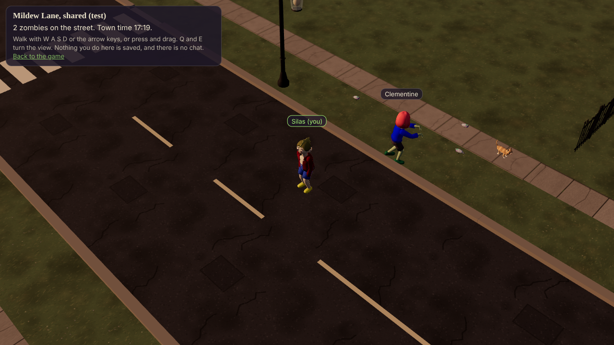

# The shared town, step 1: two browsers on the same street

This is the first working piece of the headline goal in [ROADMAP.md](../ROADMAP.md) section 4: everyone in the same
town at the same time. It is a **test page**, separate from the game, and it is **off unless you switch it on**.



## What works today

- A small server (Node.js and a WebSocket) owns one street, Mildew Lane, and decides where everybody stands.
- A page, `town.html`, draws that street with the game's own renderer and zombie models. Open it twice and each
  window shows the other's zombie walking, with a name tag.
- Your own zombie moves the moment you press a key. The page runs the server's walking rule itself and the server
  confirms it. In the browser test the page never had to be corrected.
- Up to 24 players share a room; a full room opens another (4 rooms by default).
- The town has one clock for everyone, worked out from real time (one town day lasts two real hours for now).

## What is not built

Twenty players at once has not been tried with real people or measured under load. Not built at all: walking off the
street, going into homes, regions and "only send what is near you", emotes and preset phrases, missions, accounts,
chat, and any link between the town and your own household's save. The game itself does not open the town page: there
is no button for it. Those are steps 2 to 4 of the roadmap.

## Try it on your own machine

Two terminals:

```sh
npm run town:server
```

```sh
npm run dev
```

Then open <http://localhost:5173/town.html?server=ws://127.0.0.1:8787> in two windows. Walk with W A S D or the arrow
keys, or press and drag. Q and E turn the view.

## What is sent, and what is never sent

| A browser sends | The server sends |
|---|---|
| A look made only of the game's listed options and colours | Each player's number in the room, look and preset-name number |
| The **number** of a preset name (32 names, `TOWN_NAMES`) | Positions, 15 times a second |
| A direction to walk in, 30 times a second | The town clock |

- **There is no free text anywhere.** A player cannot type a name or a message, so nothing typed can reach another
  player. A message with any unknown field is refused whole.
- **Nothing is stored.** No database, no file. When a player leaves, the server forgets them; when the last one
  leaves, the room is gone.
- **Nothing identifies a person,** with one exception that every internet server shares: the server sees the network
  address of each connection. It counts connections per address in memory (so one machine cannot fill the town) and
  never writes an address to its log.
- **Premium bodies are not shown** in the town: the server cannot check that a player owns one.

Children play this game. Putting this server on the internet for players is the owner's decision and waits for the
children's-privacy review ([ROADMAP.md](../ROADMAP.md) section 5, rule 1). A network address counts as personal
information under some children's-privacy laws, so that review has to cover it even though nothing else is collected.

## Limits the server enforces

Every limit lives in the server. The page is never trusted.

| Limit | Value | Where |
|---|---|---|
| Walking pace | 2.4 tiles a second; one step per tick, at most 6 saved up | `src/shared/townNet/room.ts` |
| Where you can walk | The street, verge to verge | `src/shared/townNet/street.ts` |
| Message size | 640 bytes | `src/shared/townNet/protocol.ts` |
| Messages per connection | 90 a second | `server/townServer.ts` |
| Connections per address | 4 | `server/townServer.ts` |
| Players per room, rooms | 24, 4 | `room.ts`, `townServer.ts` |
| Silent connection | Dropped after 30 seconds (5 seconds before saying hello) | `server/townServer.ts` |
| Which web sites may connect | Only those listed in `TOWN_ORIGINS` | `server/main.ts` |

The built town page carries a rule (its Content-Security-Policy) that lets it connect to the one server named when
it was built and to nothing else. The game's own page may connect to nobody, as before.

## How the code is laid out

| Path | What it is |
|---|---|
| `src/shared/townNet/` | The rules both sides share, with no browser or server code in them: messages, the street, the room, the clock, and the browser's prediction |
| `server/` | The server: `townServer.ts` (connections, limits) and `main.ts` (start it from the command line) |
| `src/town/` | The page: `scene.ts` (hands the renderer one zombie per player), `connection.ts` (the WebSocket), `main.ts` (keys, camera, name tags) |
| `town.html` | The page itself |
| `tests/unit/town/` | 132 tests: 83 on the rules, 24 against the real server over real connections, 25 on which page may connect to what |
| `tests/e2e/town.mjs` | 23 checks with two real browsers on the built page |

## Putting it on a host (owner only, after the review above)

```sh
npm ci
npm run build:server
TOWN_ORIGINS=https://your-site.example TOWN_TRUST_PROXY=1 PORT=8080 HOST=0.0.0.0 node dist-server/town-server.mjs
```

`dist-server/town-server.mjs` is one file and needs nothing installed beside it. The server refuses to listen beyond
its own machine unless `TOWN_ORIGINS` names the web site whose pages may connect. Build the web pages with
`VITE_TOWN_SERVER=wss://your-town-host.example` so the town page knows its server; without that setting the page
says the shared town is not switched on. `GET /healthz` returns the player and room counts for the host's health
check. Use `wss://` (TLS) on a real host: browsers refuse `ws://` from an `https://` page.

`TOWN_TRUST_PROXY=1` is for a host that puts its own proxy in front of the server, which most hosting services do.
The server then counts connections by the address that proxy reports. Without it every player would appear to come
from the proxy and the fifth player would be turned away. Leave it unset when browsers connect to the server
directly.

## Troubleshooting

| What you see | Cause | What to do |
|---|---|---|
| "The shared town is not switched on for this copy of the game." | The page was built without `VITE_TOWN_SERVER`, or the dev address has no `?server=` | Add `?server=ws://127.0.0.1:8787` in development, or rebuild with the setting |
| "Lost the town. Trying again in N s." | The server is not running, or it refused the page's web site | Start the server; on a host, check `TOWN_ORIGINS` matches the page's address exactly (scheme, host, port, no path) |
| "This page is out of date. Reload it." | The page and server were built from different versions of the messages | Rebuild and redeploy both |
| The server exits with "Refusing to start" | `HOST` is not this machine and `TOWN_ORIGINS` is empty | Set `TOWN_ORIGINS` |
| A fifth window from one machine cannot join | The per-address limit | Close a window, or raise `maxPerAddress` for a local test |
| On a host, only four players can ever join | The server sees the host's proxy as everyone's address | Set `TOWN_TRUST_PROXY=1` |
| A window left in the background says "Lost the town" and rejoins when you return | Browsers slow down hidden pages, so the server's 30-second silence limit drops them | Expected; the page reconnects by itself |
| The build stops with "VITE_TOWN_SERVER must look like..." | The setting is not `ws://` or `wss://` plus a host | Fix the value |

## Open points for the owner

1. **Day length.** One town day is two real hours as a starting value. The attack windows of
   [CORE_CONCEPT.md](CORE_CONCEPT.md) section 5 are meant in real days and are not tied to this clock.
2. **Your own zombie in town.** The page gives everyone a random look today. Bringing the zombie you made in the
   game is the next small step and needs no new data: a look is already all that is sent.
3. **Hosting.** Where the server runs and who pays for it.
