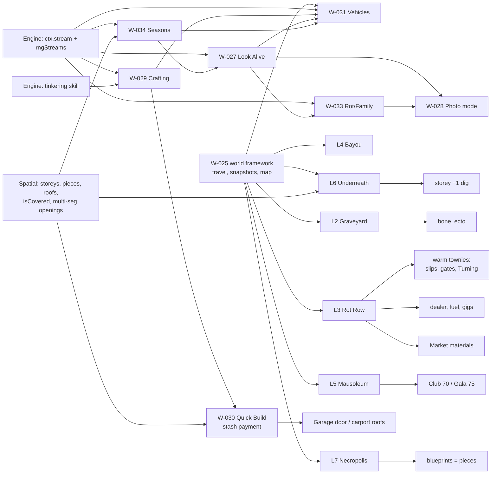
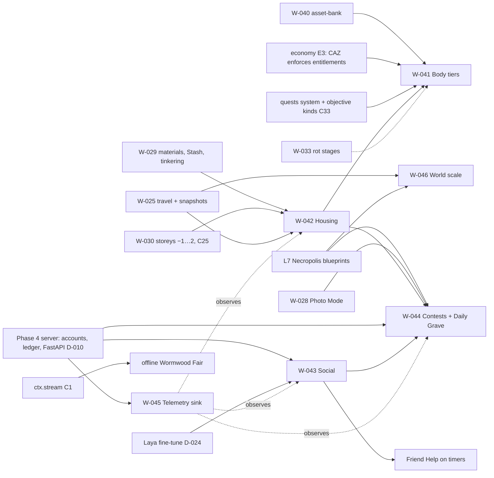

# Pillar systems: index, dependencies, build order (W-027 … W-034)

Owner of `docs/systems/**`: systems design agent (cloud), for W-035. Owner direction: `docs/DESIGN_PILLARS.md`.
Levels: `docs/levels/**` (W-026, separate agent). This index collects the cross-cutting rules, every proposed contract
change, the conflicts found in existing docs, and the open questions for the lead.

| W | Spec | Pillar | One line |
|---|---|---|---|
| W-027 | [look-alive.md](look-alive.md) | A (Sims) | Derived Passing score 0–100, mirror routines, makeup/wigs/cologne/outfits, slips with comic choices, gates for the living world |
| W-028 | [photo-mode.md](photo-mode.md) | A | Mirror selfies, the **Lookout Mirror** ("see down the road" PiP + arrivals ticker), sim photos with quality, Photo Mode, gallery, share cards |
| W-029 | [crafting-salvage.md](crafting-salvage.md) | B (Minecraft) | 7 materials, capped free sources, Stash/pockets/trunk, 4 station kinds, 36 recipes, anti-arbitrage resale, new **Tinkering** skill |
| W-030 | [quick-build.md](quick-build.md) | C (Fortnite) | 3×3-tile cells whose 3×3 edit grid maps columns to real wall segments, wood/stone/metal tiers with support spans, **storeys −1…2**, stairs/ramps/roofs |
| W-031 | [vehicles.md](vehicles.md) | D | Bike/moped/sedan/hearse, `vehicleMult` for W-025 travel, fuel/wear/breakdowns, parking objects, garage upgrades, delivery gig |
| W-033 | [rot-stages-family.md](rot-stages-family.md) | A | Fresh → Seasoned → Vintage → Legendary by undead days, consensual Turning of warm townies, weddings, house guests, rivals, family tree |
| W-034 | [seasons-weather-holidays.md](seasons-weather-holidays.md) | A | Calendar (7/14/28-day seasons), hash-deterministic 8-h weather blocks, outdoor-only effects, 4 original holidays; Halloween is always on a full moon |

(W-032 is the art lane for vehicles + Quick Build pieces; its budgets are in vehicles.md §2/§11 and quick-build.md §9.)

## 1. Dependency graph (systems ↔ systems ↔ levels)



Hard dependencies (cannot ship before):
- **W-031 Vehicles** needs **W-025** (travel) and **W-029**'s Tinkering skill (repairs; it can ship with only the $
  Mechanic path if W-029 is late).
- **W-030 Quick Build** needs the **spatial storey extension** (quick-build.md §4). The storey-0-only subset (walls,
  floors, edits, roofs at storey 0, pillars) can ship first; stairs and upper storeys come in a second drop.
- **L6** needs storey −1 from W-030 §4 (P-W11 in the levels README; this spec is its implementation).
- **W-027's gates/slips** need **L3 warm townies** (`AgentState.living`). The mirror routine + Passing can ship
  earlier (L1).
- **W-033 Turning** needs L3 warm townies + W-027 (`living`). Rot stages, weddings, guests and rivals ship with L1.

Soft dependencies (degrade gracefully): W-028 sim photos work without the renderer; the Lookout Mirror's arrivals
ticker works before W-025; the W-034 snow shelter rule reads `isCovered` (without storeys only roofs from Quick
Build matter).

## 2. Build order (recommended; parallel lanes)

| Step | Lane A (sim/spatial) | Lane B (render/assets W-032) | Lane C (UI/audio) |
|---|---|---|---|
| 0 | **Engine prerequisites:** `ctx.stream(key)` + `WorldState.rngStreams` (§4), the `tinkering` skill, lazy optional-field accessors | | |
| 1 | **W-034 seasons** (calendar, weather hash, outdoor multipliers; disabled by default for old saves) + **W-033 rot stages** (midnight counter) | sky/season palettes, precipitation, snow cover | time widget, calendar panel |
| 2 | **W-029 crafting** (stash, sources, stations, recipes) + **W-027 Look Alive core** (Passing, mirror routine, wardrobe) | benches, junk pile, dumpster, vanity, wigs, makeup shader | stash panel, recipe chooser, Looks tab |
| 3 | **W-030 Quick Build, storey 0** (pieces, edits, roofs, pillars, support refusal at L0 = n/a) | wall panel generator, roofs, pillars | Quick Build palette, edit grid, keyboard cell cursor |
| 4 | **W-030 storeys** (spatial multi-storey, stairs/ramps, support spans) | stairs/ramps GLBs, storey cutaway | storey selector |
| 5 | **W-028 photos** (sim photo items, upcomingArrivals) | mirror pass, PiP, capture, LUTs | Photo Mode, gallery, share cards (PLATFORM gallery store) |
| 6 | **W-031 vehicles** (after W-025 lands) | 4 vehicles + skins, parking objects | map ride selector, Garage screen |
| 7 | **W-027 gates/slips + W-033 Turning/weddings** with **L3** | | |
| 8 | Balance reruns per spec (§5) | perf passes on GTX 1660 + integrated GPU (W-022) | a11y pass (W-023) |

Why this order: steps 0–2 are pure additive sim work with stream isolation, so they are byte-identical-safe. Step 3
before 4 de-risks the spatial change. Vehicles wait for W-025 anyway. The gates need L3 content.

## 3. Level ↔ system introduction map

| Level | Introduces (system features) |
|---|---|
| L1 Wormwood | mirror routine + Passing (W-027), Photo Mode/selfies/Lookout Mirror (W-028), Workbench + starter recipes + junk piles (W-029), **Quick Build** storeys 0–1 wood (W-030), bike + driveway (W-031), rot stages, weddings at home, guests, rivals (W-033), calendar/weather/all holidays at home (W-034) |
| L2 Graveyard | bone + ecto sources (W-029), Bonecrete stone tier (W-030), night travel matters (W-031), Graveyard weddings (W-033), Rising Day pilgrimage (W-034) |
| L3 Rot Row | **warm townies → slips, gates, Turning** (W-027/W-033), Salon, Market materials, photo booth, dealer, fuel, delivery gigs, parking tickets, Rising Parade |
| L4 Bayou | humidity makeup fade, driftwood, stilt-house stairs, wet travel |
| L5 Mausoleum Hills | Club 70 / Gala 75, Masterwork Bench, Wrought-Iron tier + 2 upper storeys, hearse showroom, Funeral Parlor weddings, Long Night Gala |
| L6 Underneath | **storey −1** basements via Quick Build, ecto at the Catacomb Market, no weather underground |
| L7 Necropolis | blueprints = Quick Build pieces + objects, Town Gallery (photos), Founders' Wall (Legendary zombies), parade floats |

## 4. Cross-cutting rules (binding for all seven specs)

### 4.1 Determinism and RNG stream isolation
**Problem:** any new system that draws from `world.rng` shifts every later draw, so every BALANCE seed changes and the
measured targets need a full re-measure. **Rule:** new systems never touch `world.rng`.
- **Proposed contract** (`src/sim/contracts.ts` SimContext + `src/sim/types.ts` WorldState):
  ```ts
  // SimContext:
  stream(key: 'lookAlive' | 'salvage' | 'vehicles' | 'family' | 'seasons' | string): Rng;
  // WorldState (optional, additive):
  rngStreams?: Record<string, RngState>;   // created lazily on first draw: seeded from hash32(world.seed, key)
  ```
  A stream is created only on its first draw, so a world that never uses a feature has **no key** and is
  byte-identical to today's (decision #9 safe).
- Weather uses a **stateless hash** `hashRng(seed, 'weather', block)` so that forecasts are exact.
- Every spec has an **isolation acceptance test**: BALANCE scenario A seeds 11/22/33, 3 days, with the system
  registered vs not → byte-identical `WorldState` (rot stages are the documented exception if Fresh xp ×1.10 is kept,
  see rot-stages-family.md §13 / Q-R3).

### 4.2 Saves
- **No `SAVE_SCHEMA_VERSION` bump.** Every new field is optional and created on first write, following the `quests?`
  precedent in `WorldState`. `repairWorld` only clamps corrupt values and warns when it changed something (decision #9).
- New world-level (not per-lot snapshot) state: `vehicles`, `calendar`, `family`, `crafting`, household `stash`/
  `fuelUnits`/`lookAlive.wardrobe`, `rngStreams`. Per-lot (snapshot) state: `lot.storeys`, `lot.pieces`, `lot.roofs`,
  photo items, junk piles, WIP items.
- **Size budget** (DESIGN_WORLD_LEVELS ≤ 2 MB per world): a 600-piece Quick Build lot ≈ 90 KB of piece records +
  primitives; vehicles ≤ 2 KB; calendar ≤ 1 KB; stash < 0.2 KB. Gallery images are **never** in the world save
  (profile IndexedDB).

### 4.3 Skills roster (decision needed: Q-1)
The GDD has 6 skills. The levels README proposes **digging** and **fishing** (P-W2) and expects W-027 to propose
**Charm**. **This set of specs does NOT add Charm:** the shipped `charisma` already *is* the mirror-trained social
skill (GDD §7: mirror practice 30 xp/h), and Look Alive uses it as "Poise" (look-alive.md §2.1). A second social skill
would split the same fantasy. Instead this set adds **`tinkering`** (crafting, vehicle repair; DESIGN_PILLARS §D says
"Handiness/Tinkering skill"). **Total: 6 + digging + fishing + tinkering = 9**, the same count the levels README
budgeted. Migration: missing skill keys read as level 0/xp 0 in the engine accessor (no repair churn).

### 4.4 Money and balance guarantees
- No paid power anywhere: every premium/bones item in these specs has stats ≤ the best free equivalent (automated
  parity tests in each spec).
- Free money paths are capped per day (materials 60 units, crafted sales 5, photo sales 2, gigs 1 per zombie) and stay
  inside the levels README's hobby scale (below an L1 wage per hour at skill 0; about L2–L3 at skill 8–10).
- Nothing new is autonomous for unattended households, except the Look Alive routine for Vain zombies or before an
  event (none exist in BALANCE scenarios). The GDD §14 daily cap and repetition penalty apply to all of it.
- New harness scenarios: **LA** (look-alive), **CR** (crafting), **DQ** (Quick Build crypt, price parity with D),
  **V** (vehicles), **F** (60-day family), **A-S/B-S** (seasons on × 4 start seasons). Each spec lists its targets.

### 4.5 Accessibility (all UI in these specs)
Keyboard-complete flows (Quick Build cell cursor + edit grid, Garage, recipe chooser, Photo Mode panel, family tree);
screen-reader strings given per spec; `reduceMotion` honoured (camera nudges, vignettes, confetti, traffic);
colourblind glyphs on every colour-coded state (Passing bands, support overlay, stash shortfalls); lightning flash
limiter ≤ 3 per 10 s (WCAG 2.3.1).

## 5. All proposed contract changes (for the lead; all additive)

| # | File | Change | Spec |
|---|---|---|---|
| C1 | `src/sim/contracts.ts` SimContext, `src/sim/types.ts` | `ctx.stream(key)`, `WorldState.rngStreams?` | §4.1 |
| C2 | `src/sim/types.ts` SKILL_IDS + engine SkillDef | `tinkering` | crafting §8 |
| C3 | `src/sim/types.ts` AgentState | `lookAlive?`, `living?`, `pockets?`, `level?`, `undeadDays?`, `family?` | look-alive §3, crafting §8, quick-build §4.2, rot §8 |
| C4 | `src/sim/types.ts` HouseholdState | `lookAlive?.wardrobe`, `stash?`, `fuelUnits?` | look-alive, crafting, vehicles |
| C5 | `src/sim/types.ts` WorldState | `crafting?`, `vehicles?`, `family?`, `calendar?` | per spec |
| C6 | `src/sim/types.ts` LotState / WallSegment / ObjectPlacement | `storeys?`, `pieces?`, `roofs?`, `storeyVersion?`; `WallSegment.pattern?/material?/pieceId?`; `level?` on floor/wall/opening/loose; `opening.span?` | quick-build §4, vehicles §5 |
| C7 | `src/shared/dimensions.ts` | `FLOOR_SLAB`, `STOREY_HEIGHT`, `HALF_WALL`, `SHORT_WALL`, `MIN_STOREY`, `MAX_STOREY` | quick-build §4.1 |
| C8 | `src/shared/catalog.ts` PhysicalSpec | `vertical?` (stairs/ramps), `parking?` | quick-build §4.4, vehicles §5 |
| C9 | `src/sim/contracts.ts` SpatialAPI | optional `level` params; `isCovered`, `storeys`, `supportAt`; leveled path waypoints | quick-build §4.3 |
| C10 | `src/sim/contracts.ts` BuildCommand | `qbPlace`, `qbRun`, `qbEdit`, `qbMaterial`, `qbRemove`, `salvage`; optional `level` on existing commands | quick-build §4.6, crafting §8 |
| C11 | `src/sim/contracts.ts` ContentModule/Registry | `materials`, `craftRecipes`, `vehicles`, `vehicleUpgrades`, `holidays` | per spec |
| C12 | `src/sim/contracts.ts` Command / TargetRef | `vehicle` command; `TargetRef {kind:'vehicle'}` | vehicles §8 |
| C13 | `src/sim/contracts.ts` SimEvent | `slip`, `photoTaken`, `stash`, `vehicle`, `weather`, `holiday` | per spec |
| C14 | `src/sim/contracts.ts` SimulationAPI | `passing?`, `upcomingArrivals?`, `vehicles?`, `planTrip?`, `familyTree?`, `weather?` | per spec |
| C15 | `src/sim/contracts.ts` AgentSummary / PartyState / Relationship / SocialDef.outcome | `passingBand?`, `rotStage?`, `undeadDays?`; `PartyState.kind?`; `Relationship.rivals?`; outcomes `pitchAfterlife/declareRivalry/truce/turn` | look-alive, rot |
| C16 | `src/shared/world.ts` TownState.trip | `groups?`, `events?`, `tripId?` | vehicles §3 |
| C17 | `src/sim/types.ts` SimSettings | `seasons?` | seasons §5 |
| C18 | `src/render/contracts.ts` RendererAPI | `capturePhoto`, `setPip`, `pipCanvasRect`, `setPhotoMode`; per-agent `LookView`, `rotStage`; vehicle picking; view storey | photo §6, look-alive §6, quick-build §4.5 |
| C19 | `src/persistence/contracts.ts` ProfileStore | `gallery` store | photo §5 |
| C20 | `src/game/contracts.ts` GameController | photo mode API, Quick Build sub-mode state, ride plan, Garage | per spec |
| C21 | `src/shared/appearance.ts` ANIM_STATES | `applyMakeup`, `adjustWig`, `spray`, `selfie`, `pose`, `saw`, `solder`, `rummage`, `enterVehicle`, `fixVehicle`, `rideBike`, `rideMoped`, `vows`, `officiate`, `prank`, `jump`, `buildSnow`, `shiver`: **18 clips, each with a shipped fallback** | per spec |
| C22 | `src/shared/audioIds.ts` SFX_IDS | ~70 ids listed in each spec's "Audio needs" | per spec |
| C23 | `src/sim/contracts.ts` FX_KINDS | `shine`, `materials`, `petals` | look-alive, crafting, rot |
| C24 | `src/shared/styles.ts` | `wall_raw_wood/bonecrete/iron` (price 0), Deck floor style | quick-build §5.2 |
| C25 | `src/shared/world.ts` LotDef | `buildRules?: { maxStorey: number }` | quick-build §12 |

## 6. Conflicts and inconsistencies found in existing docs

| # | Where | Issue | Resolution proposed here |
|---|---|---|---|
| X1 | DESIGN_PILLARS §A says "skill: **Charm**"; levels README P-W2 expects W-027 to add Charm | Duplicates the shipped `charisma` (GDD §7 mirror practice) | Use `charisma` (shown in the Looks UI as "Poise"); add `tinkering` instead. Total skills stay 9 (§4.3) |
| X2 | DESIGN_PILLARS §B: "Sewing Table (exists)" | The shipped object is `table_stitchnmend` (Stitch-n-Mend Table, limb reattach) | Reuse it as the sewing station; limb reattach unchanged |
| X3 | DESIGN_PILLARS §D: fuel = "Embalming fluid" | Embalming fluid ($30) is a preservation cost in GDD §4; tying fuel to it would couple vehicles to the decay economy | Separate consumable "Motor-Grade Embalming Fluid" ($8/4 units) |
| X4 | DESIGN_PILLARS §D: "Handiness/Tinkering skill" | No such skill in GDD §7 | `tinkering` (C2) |
| X5 | DESIGN_PILLARS §B: "Workbench, Tinker Bench" | Neither exists in the catalog | New `bench_work`, `bench_tinker` |
| X6 | GDD §15: lot buildable 28 × 26 | Not divisible by the 3-tile Quick Build cell | 9 × 8 full cells; remainder strip stays classic-buildable; `Alt` fine snap for alignment |
| X7 | DESIGN_WORLD_LEVELS §1 v1 rule: everyone travels together | Vehicles have seat limits | Overflow rides the carpool or walks; arrival is together at max(group minutes) |
| X8 | levels README §3 travel formula + "carpool" | Carpool operating hours are undefined | Proposed: the carpool doesn't run 01:00–06:00 (vehicles.md §3), for the lead to confirm (Q-V1) |
| X9 | DESIGN_SURVIVAL_PETS_SAVES §2 mentions "Gardening skill" / "shovel skill" | Folded into digging by the levels README | Accepted; crafting uses tinkering only |
| X10 | MONETIZATION §1 boost "+1 household slot" | Ambiguous: more saved households, or household cap 9? | This set keeps the in-world cap at 8 (Q-R2) |
| X11 | Levels README §6 free freshness ≤ +10/h | The Snow Bath (+30/h for 30 min, seasonal, player-only, 1/day) exceeds it | Flagged exception (seasons §3.4, Q-S2) with a +10/h fallback |
| X12 | DESIGN_PILLARS §A "a slip (limb falls off …)" | Limb loss is the decay system's hourly roll, gated on preservation < 50 | The "Wobbly Bit" slip doubles that hour's existing chance; it never spawns limbs itself |
| X13 | GDD §2 full moon every 7th day | Season lengths 7/14/28 are multiples of 7 | Exploited on purpose: every season ends on a full moon and Halloween is always a full moon |

## 7. Open questions for the lead

| Id | Question | Default in the specs |
|---|---|---|
| Q-1 | Skills: accept `tinkering` and reject a separate Charm? | yes (§4.3) |
| Q-2 | Accept `ctx.stream()` (C1) as the RNG isolation mechanism for all new systems? | yes |
| Q-3 | Module ownership for the new systems: new modules SIM-LOOK, SIM-CRAFT, SIM-VEHICLE, SIM-SEASONS, or under SIM-HOME/SIM-PEOPLE? | proposed: look/family → SIM-PEOPLE, crafting/seasons → SIM-HOME, vehicles → the W-025 world module, Quick Build → SIM-SPATIAL |
| Q-V1 | Carpool hours 01:00–06:00 off? | yes |
| Q-V2 | Ship `door_garage` (multi-segment openings) in v1, or carports only first? | carports first; garage door v1.1 |
| Q-QB1 | Max storeys 0..2 above ground + basement −1: enough for L5 mansions? | yes |
| Q-QB2 | Quick Build hotkeys `1–6/R/F/G/V/Tab/PgUp/PgDn` only inside the Quick Build sub-mode: OK with the HUD KEYMAP owner? | yes |
| Q-R1 | Credit existing saves with `undeadDays = days since createdTick` at the first midnight? | yes |
| Q-R2 | The "+1 household slot" boost: more worlds, not a 9th member? | yes |
| Q-R3 | Keep Fresh xp ×1.10 (changes BALANCE numbers, targets expected to hold) or ×1.00 (byte-identical)? | ×1.10 + rerun |
| Q-S1 | Seasons default ON for new games, OFF (opt-in) for existing saves? | yes |
| Q-S2 | Allow the Snow Bath exception (+15 freshness/day in snow) or use the +10/h fallback? | allow |
| Q-P1 | Gallery cap 300 images / 120 MB per profile: acceptable on low-end web storage? | yes, with eviction warnings |
| Q-L1 | Living-world interview gate only on the Politics/Retail L3+ promotions? | yes (back-of-house careers are never gated) |

## References (shared)

- Fortnite edit-grid basics (community guides): [bo3.gg](https://bo3.gg/games/articles/how-to-edit-buildings-in-fortnite-2024),
  [progameguides](https://progameguides.com/fortnite/fortnite-guides/fortnite-editing-guide/).
- Survival-builder structural overlays: [Windows Central (Valheim)](https://www.windowscentral.com/valheim-building-guide-build-your-base-right-way),
  [Mobalytics (Valheim)](https://mobalytics.gg/gamebase/guides/valheim-general-building-guide).
- Life-sim seasons/calendar convention: [Sims Wiki: The Sims 4 Seasons](https://sims.fandom.com/wiki/TS4S),
  [TheGamer calendar guide](https://www.thegamer.com/the-sims-4-seasons-calendar-system-guide-tips/),
  [PCGamesN](https://www.pcgamesn.com/the-sims-4/the-sims-4-seasons).
- Only generic mechanics are adopted. All names, items, holidays, characters and art are original (TEAM_PLAN §9,
  docs/IP_NOTES.md).

---

## 8. Live-world specs (W-040 … W-046) — appended for W-047

Owner direction: `docs/DESIGN_LIVE_WORLD.md`. Same conventions as §4 (determinism, optional save fields, no paid
power, accessibility). Every spec has its own acceptance tests and open questions; this section collects the
cross-cutting parts.

| W | Spec | One line |
|---|---|---|
| W-040 | [asset-library.md](asset-library.md) | Existing private `rblake2320/asset-bank` (D-029): pipelines, semver packs (`cast@1.0.0`…), manifest + provenance schemas (AI-source records), npm (GitHub Packages) + `verify:assets` pin check, byte-identical migration with a PARKED record |
| W-041 | [body-tiers.md](body-tiers.md) | Classic free at start; all 25 cast bodies earnable via **Cast Call** quests (entitlement rewards) **and** Bones **and** GG; grandfather grant for bodies already used |
| W-042 | [housing-progression.md](housing-progression.md) | 6 home classes with limits (objects/rooms/storeys/household) and max renovation levels; Household Level; timed projects (Room Addition 2 h, New Storey 12 h, Guest Wing 1 day; Lv 10 72 h); free speed-ups, capped Rush; **shared floor 0.4 B for everyone** |
| W-043 | [social.md](social.md) | Friends (code/QR/search by band), block/report, async Home Card visits, $0 gifts, Help on timers, Crews; u15 presets-only with VPC; Laya-gated text; FastAPI sketch; inbox via journaled commands |
| W-044 | [contests-newsletter.md](contests-newsletter.md) | 6 categories on a 3-week cycle; snapshot entries rendered server-side; 1–5 stars on pairs → weighted Bradley–Terry (θ − 2σ), Glicko for pair selection; rater reputation + ring detection; Scrappy/New Builder prizes; offline Wormwood Fair; The Daily Grave (daily local + weekly online); live events |
| W-045 | [telemetry.md](telemetry.md) | Opt-in two-switch consent, none for u13/unknown; ~45 enumerated events; batch envelope; 2,000-event buffer; 90-day raw / 25-month aggregates with k ≥ 20; dashboards mapped to balance questions |
| W-046 | [world-scale.md](world-scale.md) | Lot → Neighbourhood → Town → City → Region → Country; L1–L6 = town Wormwood Heights, L7 = growing town; Ghost Train; compaction of inactive towns; pack-namespaced LevelIds |

### 8.1 Dependency graph (live-world)



Hard dependencies: W-041 needs economy E3 (CAZ enforcement) before `BODY_UNLOCKS_LIVE` flips. W-042 needs W-029
materials (it can ship with the $ fallback only) and W-030 storeys for New Storey/Basement (Room Addition, Porch,
Guest Wing and renovation levels ship without). W-043 and the online half of W-044/W-045 need Phase 4. Offline parts
ship first: housing, body tiers, the Wormwood Fair, the local Daily Grave, the telemetry schema (no-op sink).

### 8.2 Build order (live-world)

| Step | Work | Lane |
|---|---|---|
| 1 | W-040 repo + packs (byte-identical) once the owner creates the repo | assets |
| 2 | W-042 housing core (limits, HL, renovation, Room Addition/Porch/Guest Wing, timers, free speed-ups) + scenario H | sim + UI |
| 3 | W-041 Cast Calls + CAZ lock states + grandfather grant | quests + economy + UI |
| 4 | W-044 offline: Wormwood Fair + local Daily Grave | sim (game layer) + UI |
| 5 | W-046 geo data model + compaction (with L7) | world framework |
| 6 | W-045 schema expansion (no-op sink) | economy/telemetry |
| 7 | Phase 4: accounts → W-045 sink → W-043 social → W-044 online contests → Rush Order | server |

### 8.3 Proposed contract changes (continuing after C25; all additive)

| # | File | Change | Spec |
|---|---|---|---|
| C26 | `src/sim/types.ts` HouseholdState | `level?: { xp, level, capDay, capCounts }` (Household Level) | housing §4 |
| C27 | `src/sim/types.ts` LotState | `home?: HomeState` (renovation, extensions, projects, queue, favour) + `ProjectState` | housing §10 |
| C28 | `src/sim/contracts.ts` Command | `project` (start/queue/cancel/speedup with `ledgerKey`) | housing §10 |
| C29 | `src/sim/contracts.ts` SimEvent | `project`, `householdLevel` | housing §10 |
| C30 | `src/sim/contracts.ts` SimulationAPI / BuildPreview | `home?()`, `homeLimits?()`; reasons `limit:objects\|rooms\|storey\|basement` | housing §2, §10 |
| C31 | `src/shared/world.ts` LotDef | `homeClass?: HomeClass` | housing §3 |
| C32 | `src/sim/types.ts` SimSettings | `housing?: boolean` (ON new games, OFF old saves) | housing §2 |
| C33 | `src/sim/contracts.ts` ObjectiveDef | `renovation {level}`, `householdLevel {level}`, `rotStage {stage}` | housing §11, body-tiers §6 |
| C34 | `src/shared/economy.ts` | server consumables (Rush Order hours, Rush Credit) | housing §7.2 |
| C35 | `src/shared/economy.ts` CatalogEntry / ledger | `earn?: EarnPath`; entitlement-only grants with `amount: 0` (or keep 1) | body-tiers §4, §6 |
| C36 | `src/game/contracts.ts` | CAZ body lock state (`BodyLock`) | body-tiers §6 |
| C37 | `src/shared/social.ts` (new) | FriendSummary, HomeCardV1, InboxItem, PresetPhraseId, CrewView | social §11 |
| C38 | `src/sim/contracts.ts` Command / SimEvent; `WorldState.inbox?` | `inbox` command (journaled application of helps/gifts) | social §6 |
| C39 | server + `src/shared/economy.ts` | `AgeBand` `u13\|13-15\|16-17\|18+` (server-side; client keeps AgeBracket) | social §2 |
| C40 | `src/shared/contests.ts` (new) | ContestDef, EntrySnapshot, EntryView, VotePair | contests §11 |
| C41 | photo-mode PhotoRecord / render contract | `contest?` link; headless `renderEntrySnapshot` for render workers | contests §3, §11 |
| C42 | `src/economy/analytics.ts` → `src/shared/telemetry.ts` | expanded event union + ALLOWED_KEYS | telemetry §4 |
| C43 | `src/persistence/contracts.ts` ProfileStore | `telemetry` buffer store | telemetry §5 |
| C44 | `src/shared/world.ts`, `WorldState.geo?` | TownDef/CityDef/RegionDef/CountryDef, `LevelDef.townId?` | world-scale §6 |
| C45 | `src/shared/world.ts` LevelId | `BuiltinLevelId \| '<pack>:<slug>'` | world-scale §6 |
| C46 | asset manifests | `pack`, `packVersion`, `loaderSpec`, `builtFrom`, per-asset `provenance`, `license` | asset-library §3.2 |
| C47 | `package.json`, `scripts/` | pinned asset-bank commit (git), hash-verified import, `sync-assets.mjs`, verify pin check | asset-library §6 |

(Also used, already proposed elsewhere: C1 `ctx.stream` for the Fair; C2 tinkering for timers; C16 trip groups;
C21 `saw`/`solder` for Pitch In; C22 SFX `projectStart`, `crewHammer`, `projectDone`, `coffeeSlurp`; P-W1/P-W6
`grantLevelUnlock`/`visitLot`.)

### 8.4 Conflicts found (continuing after X13)

| # | Where | Issue | Resolution proposed |
|---|---|---|---|
| X14 | DESIGN_LIVE_WORLD §3 order "Bayou stilt → Rot Row apartment → Mausoleum" | Rot Row apartments ($12–16k, day 3) are cheaper and unlock earlier than the Bayou ($13–17k, $15k funds) | Classes order by size/limits; apartments are the small central option (housing §3) |
| X15 | DESIGN_LIVE_WORLD §3 "additions take time (room 2 h)" vs GDD §15 instant build with exact undo | Timing every wall breaks the build sandbox and the undo contract | Build stays instant within limits; timed projects raise limits (Room Addition 2 h, New Storey 12 h, Guest Wing 1 day) |
| X16 | GDD §9 household cap 8 / `social_moveIn` "household < 8" | Per-home household limits are new gates | Only with `housing` ON; existing households grandfathered; hard cap 8 unchanged |
| X17 | `catalog.ts` `body:gold` premium-only | DESIGN_LIVE_WORLD §2: every body has an earnable path | Goldie Cast Call (`funds 25000`) + Bones 900; GG and Starter Pack kept |
| X18 | `catalog.ts`: 18 bodies `free`, `BODY_UNLOCKS_LIVE = false` | Owner: free starter = Classic | Bodies become earnable; grandfather grant for any body already used in a save |
| X19 | DESIGN_WORLD_LEVELS §1 ≤ 2 MB per world | Several towns exceed it | ≤ 2 MB active town + compacted inactive towns, ≤ 4 MB per world (Q-W1) |
| X20 | L7 §4.4 "Doff Hat" likes + weekly featuring | Overlaps with W-044 contests | Doff Hat stays for blueprint browsing; Daily Grave features come from contests |
| X21 | L7 §4.1 commissioned build "instant, or Build over a day" | Timers now exist | Commissioned builds are projects (kind `commission`, S from object/wall counts), discount rule kept |
| X22 | MONETIZATION §1 boost "extra build lot slots" | Could be read as paid build-crew slots | Lot slots ≠ crew slots; crew slots are never sold (2nd free at HL 12) |
| X23 | Levels L1 Q2 / L5 "Move Household flow unspecified" | Needed for buyable homes | Defined in housing §9 |
| X24 | MONETIZATION §1 "cast bodies in rotation" (Bones) | Rotation implies FOMO for an earnable unlock | Bones prices always available; only the Featured tab rotates (Q-B4) |
| X25 | photo-mode §5 "no in-game upload before Phase 4" | Contests need uploads | Online contests are Phase 4 and upload structured snapshots, rendered server-side; offline Fair needs no upload |
| X26 | GDD §17 / MONETIZATION §2: "+career XP ×1.25" boost | Indirectly speeds Household Level | Accepted as edge, not lock (Q-H4); alternative: HL ignores boosted promotions |

### 8.5 Open questions for the lead (live-world)

Per spec: housing Q-H1…Q-H7, body tiers Q-B1…Q-B4, social Q-S1…Q-S5 (social.md; distinct from seasons' Q-S1/Q-S2 in
§7 above — read as `social:Q-S1`), contests Q-C1…Q-C5, telemetry Q-T1…Q-T4, world scale Q-W1…Q-W4, asset library
Q-A1…Q-A4. The ones that block implementation start:

| Id | Question | Default |
|---|---|---|
| Q-H1 | Instant build within limits + timed limit-raising projects? | yes |
| Q-H3 | Housing ON for new games, OFF (opt-in) for old saves (D-019 pattern)? | yes |
| Q-B1 | Classic only at start, Walker after the first story quest? | yes |
| social:Q-S2 | u13 online needs VPC; presets only, off until a parent enables? | yes |
| social:Q-S3 | Free text only after the Laya recall gate? | yes |
| Q-W1 | Save budget ≤ 4 MB per world with ≤ 2 MB active town? | yes |
| Q-A1 | npm (GitHub Packages) vs submodule for packs? | npm |

### 8.6 Proposed rows for `docs/DECISIONS.md` (lead to record)

| Decision | Why | Rejected |
|---|---|---|
| Building stays instant; timers only on limit-raising projects | Keeps the sandbox and undo contract; matches the owner's examples | Timed walls/rooms (breaks undo, slows the core build loop) |
| Every project shares a floor of 0.4 B; paid ≤ half the 0.6 B cap | Provable "edge, never a lock" | Uncapped paid skips (pay-to-progress); no paid option (owner wants an edge) |
| Timers run on sim ticks, paused when the game is closed | Determinism, journal replay, life-sim time | Wall-clock timers (non-deterministic, mobile timer walls) |
| Cast bodies unlock through quests that grant entitlements | Reuses the idempotent quest → ledger path; no new unlock code | A separate unlock tracker |
| Contest voting on server renders of structured snapshots | Fair comparisons; no arbitrary image uploads | Player screenshots (fakeable, moderation load) |
| Weighted Bradley–Terry with a prior, ranked by θ − 2σ | Robust with few votes; principled uncertainty | Raw star averages (few-vote entries win) |
| No telemetry at all for under-15/unknown | COPPA + ICO high-privacy defaults; simplest safe rule | Internal-operations crash data for u13 |
| Assets as semver packs on GitHub Packages, byte-identical migration | Reuse across games with pinned, verified versions | Copy-paste per game; a monorepo |

### References (live-world, collected; each spec lists its own)

- Base-builder help/timer mechanics: [Rise of Kingdoms wiki: Alliance Center](https://riseofkingdoms.fandom.com/wiki/Buildings/Alliance_Center),
  [BlueStacks: Dark War Survival alliance guide](https://www.bluestacks.com/blog/game-guides/dark-war-survival/dws-alliance-guide-en.html),
  [Clash of Clans wiki: Magic Items](https://clashofclans.fandom.com/wiki/Magic_Items/List).
- Creator showcases: [EA Help: The Sims 4 Gallery](https://help.ea.com/help/the-sims/the-sims-4/the-sims-4-gallery).
- Ranking: [Evan Miller](https://www.evanmiller.org/how-not-to-sort-by-average-rating.html), [Chen et al. JMLR 2016](https://jmlr.csail.mit.edu/papers/v17/16-066.html),
  [Glicko](https://en.wikipedia.org/wiki/Glicko_rating_system), [Allahbakhsh et al. (collusion)](https://arxiv.org/pdf/1211.0963).
- Children's privacy: [Wiley on the 2025 COPPA amendments](https://www.wiley.law/alert-FTC-Adopts-Amended-Childrens-Online-Protection-Act-Rule),
  [ICO Children's Code](https://ico.org.uk/media/for-organisations/uk-gdpr-guidance-and-resources/childrens-information/childrens-code-guidance-and-resources/age-appropriate-design-a-code-of-practice-for-online-services-2-1.pdf).
- AI assets: [US Copyright Office Part 2](https://copyright.gov/newsnet/2025/1060.html), [Steam AI disclosure (PC Gamer)](https://www.pcgamer.com/valve-updates-its-steam-policy-on-ai-so-it-can-release-the-vast-majority-of-games-that-use-it).
- Only mechanics are learned; every name, number set, item and layout here is original (TEAM_PLAN §9, IP_NOTES).
